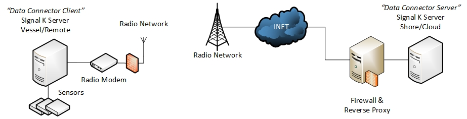

# Signal K Edge Link

[](https://www.npmjs.com/package/signalk-edge-link)
[](LICENSE)
[](https://nodejs.org)

A Signal K plugin that copies live vessel data from one Signal K server to another over encrypted UDP. It is built for links that drop packets, add latency or charge by the byte, such as cellular and satellite.

Typical use: a boat sends its data to a shore server, or several boats report to one hub and see each other.



## What it does

- **Client connection:** subscribes to local Signal K data, batches it, compresses it (Brotli, optionally MessagePack and a path dictionary), encrypts it (AES-256-GCM) and sends it over UDP.
- **Server connection:** receives, decrypts and decompresses the packets and writes the data into its local Signal K server, keeping each value's source.
- **Advanced mode** (protocol v3) adds, for unreliable links:
  - delivery checks with retransmission (ACK/NAK)
  - path metadata (units, descriptions, zones)
  - congestion control
  - optional failover between two links (bonding)
  - monitoring and alerts
- One Signal K server can run any number of client and server connections, each with its own key and port.

## Topologies

| Setup                 | What happens                                                                                                                                                                                                                                                                                                                                                                                                                                                                   |
| --------------------- | ------------------------------------------------------------------------------------------------------------------------------------------------------------------------------------------------------------------------------------------------------------------------------------------------------------------------------------------------------------------------------------------------------------------------------------------------------------------------------ |
| Point to point        | One client sends to one server.                                                                                                                                                                                                                                                                                                                                                                                                                                                |
| Many vessels, one hub | Several clients send to one shore server.                                                                                                                                                                                                                                                                                                                                                                                                                                      |
| Bonding               | One client sends over two links (for example LTE and Starlink) and fails over between them. See [`docs/bonding.md`](docs/bonding.md).                                                                                                                                                                                                                                                                                                                                          |
| Relay chain           | One Signal K server runs a server and a client connection, receiving on one hop and forwarding on the next. Each hop has its own key and settings.                                                                                                                                                                                                                                                                                                                             |
| Fleet sharing         | Vessels reporting to a hub also receive the other vessels' data back over the same link. No inbound port is needed on the vessels, and a vessel never receives its own data. The client's heartbeats keep the vessel's NAT mapping open as long as `heartbeatInterval` is shorter than the NAT's UDP timeout; if the mapping expires, fleet data resumes when the client next sends, or within about a minute, once the client re-sends HELLO, if the NAT assigned a new port. |

```text
  [Vessel A] ──┐             ┌──► A gets B, C
  [Vessel B] ──┼──► [Hub] ───┼──► B gets A, C
  [Vessel C] ──┘             └──► C gets A, B
```

Fleet sharing is off by default: set `fleetSharing.enabled` on the server and on each client. It needs Advanced mode and version 4.4.0 or later on every node, relays included, and a client cannot use it together with bonding. See [Fleet Sharing](docs/configuration-reference.md#fleet-sharing-advancedv3-only).

## Requirements

- Two Signal K servers, with Node.js 24 or later.
- The client can reach the server's UDP port (default `4446`).
- The same encryption key on both ends: 32 printable ASCII characters without spaces, 64 hex characters, or base64 of exactly 32 bytes. Weak, low-variety keys are rejected whatever their length. Generate one with `openssl rand -hex 32`.

## Install

Install **Signal K Edge Link** from the Signal K App Store (plugin manager), then restart Signal K.

From source:

```bash
cd ~/.signalk/node_modules
git clone https://github.com/KEGustafsson/signalk-edge-link.git
cd signalk-edge-link
npm install
npm run build
```

Then restart Signal K.

## Quick start

In the Signal K Admin UI, open **Server → Plugin Config → Signal K Edge Link** on each server.

The plugin is disabled after install (`signalk-plugin-enabled-by-default: false`). Enable it on this page on both servers; saving the connection configuration alone does not start it.

A fresh install shows one empty client card. Configure that card in the steps below rather than adding a second one. The last card cannot be removed, and an empty card fails validation when you save.

1. **Receiving server:** switch the initial card's type to server (or click **Add Server**, then remove the initial card). Set a name, the UDP port, the encryption key and protocol **Advanced**. Save.
2. **Sending server:** use the initial client card. Set a name, the receiving server's address, the same UDP port, the same key and protocol **Advanced**. Save.
3. **Check:** open `http://<signalk-host>:3000/plugins/signalk-edge-link/` on both servers. The client's **Deltas Sent** and the server's **Deltas Received** should rise, and the encryption error counts should stay at zero.

Each Signal K server stores its own list of connections and starts every connection in it. The two lists for the steps above:

Receiving server (shore):

```json
{
  "connections": [
    {
      "name": "shore-server",
      "serverType": "server",
      "udpPort": 4446,
      "secretKey": "<key>",
      "protocolVersion": 3
    }
  ]
}
```

Sending server (boat):

```json
{
  "connections": [
    {
      "name": "boat-client",
      "serverType": "client",
      "udpAddress": "shore.example.com",
      "udpPort": 4446,
      "secretKey": "<key>",
      "protocolVersion": 3
    }
  ]
}
```

Every setting, default and range is in [`docs/configuration-reference.md`](docs/configuration-reference.md). Example files are in [`samples/`](samples/).

## Basic or Advanced?

| Mode         | Protocol | Use for                                  | Adds                                                                                 |
| ------------ | -------- | ---------------------------------------- | ------------------------------------------------------------------------------------ |
| **Advanced** | v3       | Any WAN link: cellular, satellite, Wi-Fi | Retransmission, congestion control, bonding, metadata, authenticated control packets |
| **Basic**    | v1       | Stable local links only                  | Lowest overhead; no delivery checks, no metadata                                     |

Use Advanced for new deployments. Both ends of a connection must use the same mode.

## Monitoring and management

- **Dashboard:** `/plugins/signalk-edge-link/` shows each connection's traffic, link quality and alerts. See [`docs/web-ui.md`](docs/web-ui.md).
- **REST API and Prometheus:** under `/plugins/signalk-edge-link`, for example `GET /metrics` and `GET /prometheus`. See [`docs/api-reference.md`](docs/api-reference.md) and [`docs/metrics.md`](docs/metrics.md).
- **CLI:** `edge-link-cli help` manages instances and bonding. Run it from the plugin directory (`~/.signalk/node_modules/signalk-edge-link`) as `npm run cli -- help` or `node lib/bin/edge-link-cli.js help`. An App Store install also links `~/.signalk/node_modules/.bin/edge-link-cli`; a source install does not. See [`docs/management-tools.md`](docs/management-tools.md).
- **Access control:** set `managementApiToken` (or `SIGNALK_EDGE_LINK_MANAGEMENT_TOKEN`) to require a token on every route. Send it as `X-Edge-Link-Token: <token>` or `Authorization: Bearer <token>`.

## Security

- Every data packet is encrypted and authenticated with AES-256-GCM. In Advanced mode, control packets are also authenticated, and DATA and METADATA headers are authenticated by default (`authenticatedHeaders`, which both peers can turn off).
- Allow the UDP port only from addresses you trust where you can.
- Details, limits and hardening steps: [`docs/security.md`](docs/security.md).

## Documentation map

| Document                                                             | Covers                                              |
| -------------------------------------------------------------------- | --------------------------------------------------- |
| [`docs/GUIDE.md`](docs/GUIDE.md)                                     | Full setup and operations guide                     |
| [`docs/configuration-reference.md`](docs/configuration-reference.md) | Every setting, default and range                    |
| [`docs/web-ui.md`](docs/web-ui.md)                                   | Configuration panel and dashboard, including relays |
| [`docs/troubleshooting.md`](docs/troubleshooting.md)                 | Symptoms, causes and fixes                          |
| [`docs/security.md`](docs/security.md)                               | Encryption, keys and hardening                      |
| [`docs/bonding.md`](docs/bonding.md)                                 | Dual-link failover                                  |
| [`docs/congestion-control.md`](docs/congestion-control.md)           | Rate control and tuning                             |
| [`docs/performance-tuning.md`](docs/performance-tuning.md)           | Tuning by hardware profile                          |
| [`docs/metrics.md`](docs/metrics.md)                                 | JSON and Prometheus metrics, alerts                 |
| [`docs/api-reference.md`](docs/api-reference.md)                     | REST endpoints                                      |
| [`docs/management-tools.md`](docs/management-tools.md)               | Management token, web UI token, CLI                 |
| [`docs/protocol-v3.md`](docs/protocol-v3.md)                         | How Basic and Advanced modes work                   |
| [`docs/protocol-v3-spec.md`](docs/protocol-v3-spec.md)               | Wire format specification                           |
| [`docs/architecture-overview.md`](docs/architecture-overview.md)     | Code architecture and lifecycle                     |
| [`docs/release-checklist.md`](docs/release-checklist.md)             | Steps before publishing a release                   |
| [`docs/README.md`](docs/README.md)                                   | Index of all documentation                          |

## Development

Build, test and lint commands: [`docs/GUIDE.md`](docs/GUIDE.md#20-developer-reference).

Legacy single-object configs still run: startup wraps them in a one-entry `connections[]` without rewriting the file. To convert the file, run `npm run migrate:config -- <input.json> [output.json]` from the plugin's directory (for example `~/.signalk/node_modules/signalk-edge-link`), with paths relative to it or absolute; without `output.json` it overwrites `input.json`, so give a separate output path to keep the original.

## License

MIT. See [LICENSE](LICENSE).
