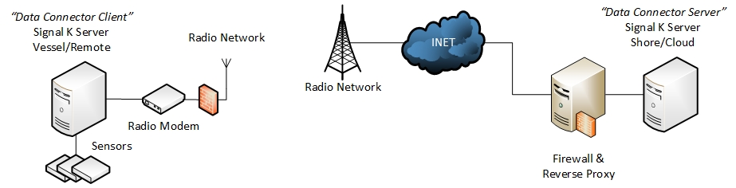

# Signal K Edge Link — Setup and Operations Guide

How to install the plugin, set up each topology, and run it day to day. This guide matches release 4.4.0 (current: 4.4.0). Every setting, endpoint and metric has a reference doc; this guide links to it instead of repeating it.



## Contents

1. [What It Does](#1-what-it-does)
2. [How Data Flows](#2-how-data-flows)
3. [Requirements](#3-requirements)
4. [Installation](#4-installation)
5. [Quick Start — Minimal Setup](#5-quick-start--minimal-setup)
6. [Basic or Advanced](#6-basic-or-advanced)
7. [Connections](#7-connections)
8. [Runtime Configuration Files](#8-runtime-configuration-files)
9. [Topology: Point to Point](#9-topology-point-to-point)
10. [Topology: Many Vessels to One Server](#10-topology-many-vessels-to-one-server)
11. [Topology: Bonding](#11-topology-bonding)
12. [Topology: Relay Chain](#12-topology-relay-chain)
13. [Topology: Fleet Sharing](#13-topology-fleet-sharing)
14. [Keys and Access Control](#14-keys-and-access-control)
15. [Dashboard and Status](#15-dashboard-and-status)
16. [Metrics and Alerts](#16-metrics-and-alerts)
17. [Changing Configuration](#17-changing-configuration)
18. [Upgrades and Migration](#18-upgrades-and-migration)
19. [Troubleshooting](#19-troubleshooting)
20. [Developer Reference](#20-developer-reference)

---

## 1. What It Does

Signal K Edge Link copies Signal K deltas from one Signal K server to another over encrypted UDP. It targets links with packet loss, variable latency or per-byte cost: cellular, satellite, Wi-Fi.

- A **client** connection subscribes to local Signal K data, batches, compresses and encrypts it, and sends it over UDP.
- A **server** connection receives, decrypts and decompresses the packets and writes the deltas into its local Signal K tree, keeping each value's source.
- One plugin runs any number of client and server connections. Each has its own UDP socket, key, port, retransmit queue, congestion state, metrics and runtime config files.

Protocol v2 was removed in 3.0.0 because its control packets were unauthenticated. A stored `protocolVersion: 2` is accepted and coerced to `3`. Peers running a build older than 3.0.0 speak v2 and cannot exchange data with a v3 peer.

## 2. How Data Flows

Client, in order:

1. Subscription filter (`subscription.json`, or all paths).
2. `skipOwnData` filter (optional): drops `networking.edgeLink.*` from the forwarded data.
3. Duplicate suppression: identical (context, source, values) sent once per 1500 ms.
4. Batching: up to the batch limit, or when the delta timer fires (default 1000 ms).
5. Serialize as JSON, or MessagePack with `useMsgpack`. Optional path dictionary (`usePathDictionary`).
6. Brotli compression (quality 6 by default, `brotliQuality`).
7. AES-256-GCM encryption: `[12-byte IV][ciphertext][16-byte tag]`.
8. Advanced (v3): 15-byte header, copy kept in the retransmit queue (default 5000 entries), then UDP send.

Server, in order:

1. Advanced (v3): rate limit of 200 DATA packets per second per client, at most 5 sessions per source IP.
2. Advanced (v3): header check (magic `SK`, version, CRC16, HMAC tag); mismatches are dropped.
3. AES-256-GCM decrypt; a failed tag is counted as an encryption error.
4. Brotli decompress, capped at 10 MB of output.
5. Path dictionary decode, deserialize.
6. Advanced (v3): sequence tracking, NAK for gaps, cumulative ACK every `ackInterval` (default 100 ms).
7. Source normalization, then `app.handleMessage` into the local tree.

Diagrams and module responsibilities: [architecture-overview.md](architecture-overview.md). Wire format: [protocol-v3-spec.md](protocol-v3-spec.md).

## 3. Requirements

- Two Signal K servers with Node.js 24 or later (`node --version`).
- The client can reach the server's UDP port (default `4446`).
- The same encryption key on both ends of each connection: 32 ASCII characters, 64 hex characters or 44 base64 characters.

## 4. Installation

From the Signal K Admin UI: **Server → Plugin Config** (App Store), search for **Signal K Edge Link**, click **Install**, restart Signal K.

From source:

```bash
cd ~/.signalk/node_modules
git clone https://github.com/KEGustafsson/signalk-edge-link.git
cd signalk-edge-link
npm install
npm run build        # compiles TypeScript and builds the web UI into public/
sudo systemctl restart signalk   # or however your Signal K server is run
```

## 5. Quick Start — Minimal Setup

Generate one key and use it on both servers:

```bash
openssl rand -hex 32
```

In the Signal K Admin UI, open **Server → Plugin Config → Signal K Edge Link** on each server.

1. **Receiving server (shore):** click **+ Add Server**. Set **Connection Name** (for example `shore-server`), **UDP Port** `4446`, **Encryption Key**, and **Protocol Version** Advanced. Click **Save**.
2. **Sending server (vessel):** click **+ Add Client**. Set **Connection Name** (for example `vessel-client`), **Server Address** (hostname or IP of the shore server), the same **UDP Port**, the same key and Advanced. Click **Save**.

Saving restarts the plugin; no separate restart is needed. The resulting configuration:

```json
{
  "connections": [
    {
      "name": "shore-server",
      "serverType": "server",
      "udpPort": 4446,
      "secretKey": "<64-hex-key>",
      "protocolVersion": 3
    },
    {
      "name": "vessel-client",
      "serverType": "client",
      "udpAddress": "shore.example.com",
      "udpPort": 4446,
      "secretKey": "<64-hex-key>",
      "protocolVersion": 3
    }
  ]
}
```

The default `protocolVersion` is `1` (Basic). Set `3` (Advanced) explicitly.

3. **Check:** open `http://<signalk-host>:3000/plugins/signalk-edge-link/` on both servers. The client's **Deltas Sent** and the server's **Deltas Received** should rise, and encryption errors should stay at `0`. From the command line:

```bash
curl -s -H "X-Edge-Link-Token: $TOKEN" http://vessel:3000/plugins/signalk-edge-link/metrics \
  | jq '{sent:.stats.deltasSent, encErr:.stats.encryptionErrors, ready:.status.readyToSend}'
curl -s -H "X-Edge-Link-Token: $TOKEN" http://shore:3000/plugins/signalk-edge-link/metrics \
  | jq '{rcvd:.stats.deltasReceived, encErr:.stats.encryptionErrors}'
```

The token header is needed only when a management token is configured ([section 14](#14-keys-and-access-control)).

## 6. Basic or Advanced

| Mode         | `protocolVersion` | Use for                                  | Has                                                                                                              |
| ------------ | ----------------- | ---------------------------------------- | ---------------------------------------------------------------------------------------------------------------- |
| **Advanced** | `3`               | Any WAN link: cellular, satellite, Wi-Fi | ACK/NAK retransmission, congestion control, bonding, fleet sharing, metadata, HMAC-authenticated control packets |
| **Basic**    | `1`               | Stable local links only                  | Encryption and compression; no retransmission, no metadata, RTT only from an external ping monitor               |

- Use Advanced for new deployments. Both ends must use the same mode; a mismatch drops every packet and raises `malformedPackets`.
- Basic clients may set `testAddress`, `testPort` and `pingIntervalTime` for the ping monitor (published as `networking.modem.rtt`). Advanced configs must not contain these fields.
- These must also match on both ends: `secretKey`, `stretchAsciiKey`, `useMsgpack`, `usePathDictionary`, `useValueDedup`, `useCompactDeltas`, `authenticatedHeaders`, `epochBoundAuth`.

How the two modes work: [protocol-v3.md](protocol-v3.md). Settings and defaults: [configuration-reference.md](configuration-reference.md).

## 7. Connections

Configuration is a `connections` array; each entry is one independent link. A legacy single-object config is converted to a one-item array at startup ([section 18](#18-upgrades-and-migration)).

- Each server connection needs its own UDP port. The configuration panel blocks a save with duplicate server ports.
- `name` (max 40 characters) labels the connection in the UI and logs and names its runtime config directory.
- Server connections must not contain `congestionControl`, `bonding`, `alertThresholds` or `skipOwnData`. The full validation rules are in [configuration-reference.md](configuration-reference.md).

**Partial startup failure.** A connection that fails to start (for example `EADDRINUSE` on its `udpPort`, or an interface that is not up yet) does not stop the others. It stays registered and shows as unhealthy, and the plugin status reads `N/M active — <name>: <error>`. The failed connection is retried with exponential backoff from 30 s up to 300 s, so it comes up once the cause clears. If every connection fails, the status is `Startup failed: <first error>`.

## 8. Runtime Configuration Files

Each client connection has three JSON files that change behavior without a plugin restart. They live in `<signalk-data-dir>/plugin-config-data/signalk-edge-link/<connectionName>/` and are reloaded 300 ms after a change.

| File                   | Controls                                                                                   |
| ---------------------- | ------------------------------------------------------------------------------------------ |
| `delta_timer.json`     | Fixed send interval (`deltaTimer`, 100–10000 ms); when set, congestion control is bypassed |
| `subscription.json`    | Context and paths to send, and metadata streaming (`meta.enabled`, Advanced only)          |
| `sentence_filter.json` | NMEA sentence types to drop before sending (`excludedSentences`, for example `GSV`, `GSA`) |

Edit them in the dashboard, or with `GET`/`POST /plugins/signalk-edge-link/connections/:id/config/:filename`. Field reference: [configuration-reference.md](configuration-reference.md).

## 9. Topology: Point to Point

One client sends to one server. The [Quick Start](#5-quick-start--minimal-setup) configuration is the minimal form. For a WAN link, add to the client:

```json
{
  "useMsgpack": true,
  "usePathDictionary": true,
  "congestionControl": { "enabled": true, "targetRTT": 300 }
}
```

and set `useMsgpack` and `usePathDictionary` on the server too, since both must match. On the server, `"requestFullStatusOnRestart": true` makes the client replay its full current state after a server restart (at most once per 10 s per client).

Set `targetRTT` near the link's normal RTT. Values by link type, and profiles for Raspberry Pi and satellite: [performance-tuning.md](performance-tuning.md). Algorithm and tuning: [congestion-control.md](congestion-control.md).

**Check:** Deltas Sent and Deltas Received rising, encryption errors `0`, and on the client `networkQuality.rtt` present and `queueDepth` near `0`.

## 10. Topology: Many Vessels to One Server

Several clients send to one shore server connection. All of them use that connection's `udpPort` and `secretKey`.

```text
  [Vessel A] ──┐
  [Vessel B] ──┼──► [Shore: one server connection, port 4446]
  [Vessel C] ──┘
```

- A server connection holds up to 100 client sessions (`MAX_CLIENT_SESSIONS` in `src/foundation/constants.ts`), at most 5 per source IP, and accepts at most 200 DATA packets per second per client.
- To give vessels different keys, add one server connection per key, each on its own port.

The server keeps a registry of every data source seen across its clients, from normal DATA ingest (`update.source` / `$source`; it does not need metadata streaming). The full registry is `GET /sources`; merge counters are under `sourceReplication.metrics` in `GET /metrics`. Record fields: [metrics.md](metrics.md). Registry rules not documented elsewhere:

- Key: `source-ref:<$source>` when `$source` is present, otherwise `source-identity:<sha256>` of the canonical identity (`identity.type`, `label`, `src`, `instance`, `pgn`, `deviceId`). Source fields are kept as the client sent them, including legacy `$source` values.
- Merge: field by field; an empty or undefined incoming field never clears a stored value; conflicts go to the latest update timestamp (current time when there is none). A merge that changes nothing has an unchanged `mergeHash` and is counted in `noops`.
- Each record keeps `raw.source` and `raw.$source`. Responses also carry legacy lookups `legacy.byLabel[label]` and `legacy.bySourceRef[$source]`, each mapping to the canonical key.

**Check:** `GET /status` lists the server instance as healthy; `GET /sources` grows as vessels report. To have the vessels see each other, see [Fleet Sharing](#13-topology-fleet-sharing).

## 11. Topology: Bonding

One client sends over two links (for example LTE and Starlink) in `main-backup` mode and fails over when the primary's RTT or loss crosses a threshold or the link stops answering. The shore side runs one server connection per link port, both with the same key.

```json
{
  "name": "vessel-bonded",
  "serverType": "client",
  "secretKey": "<64-hex-key>",
  "protocolVersion": 3,
  "bonding": {
    "enabled": true,
    "mode": "main-backup",
    "primary": { "address": "shore.example.com", "port": 4446, "interface": "192.168.1.100" },
    "backup": { "address": "shore.example.com", "port": 4447, "interface": "10.0.0.100" }
  }
}
```

Shore: two server connections, `udpPort` `4446` and `4447`. Primary and backup must differ in address:port. `interface` binds the outbound socket to a local IP. Bonding cannot be combined with `fleetSharing` on the same client.

**Check:** `GET /bonding` shows `activeLink` and both links' `status`, `rtt` and `loss`; a backup reading `down` means its heartbeats get no reply. `POST /bonding/failover` switches links by hand. A notification `notifications.signalk-edge-link.<instanceId>.linkFailover` fires on each failover; `<instanceId>` is the connection name lowercased with other characters replaced by `-` (`Shore Server` → `shore-server`).

Failover and failback rules, thresholds and threshold profiles: [bonding.md](bonding.md). Sample: [`samples/v3-with-bonding.json`](../samples/v3-with-bonding.json).

## 12. Topology: Relay Chain

One Signal K server runs a server connection for the incoming hop and a client connection for the outgoing hop. Data received on the server connection enters the relay's tree, and the client connection forwards it.

```text
  [Vessel] ──hop 1──► [Relay: server + client] ──hop 2──► [Shore]
```

```json
{
  "connections": [
    {
      "name": "from-vessel",
      "serverType": "server",
      "udpPort": 4446,
      "secretKey": "<key-for-hop-1>",
      "protocolVersion": 3
    },
    {
      "name": "to-shore",
      "serverType": "client",
      "udpAddress": "hq.example.com",
      "udpPort": 4450,
      "secretKey": "<key-for-hop-2>",
      "protocolVersion": 3,
      "skipOwnData": true
    }
  ]
}
```

- The hops are independent: separate keys, handshakes, reliability settings and `epochBoundAuth` values. Each hop must agree with itself; the hops need not agree with each other.
- `skipOwnData: true` on the relay's client keeps the relay's own `networking.edgeLink.*` metrics out of the forwarded data. Link telemetry the peer needs is still sent.
- A relay may run more than one client connection, for example to a primary and a backup shore server.
- When a connection has an instance ID, its Signal K paths are `networking.edgeLink.<instanceId>.*`, which keeps the two connections apart.

**Check:** the relay's dashboard has two tabs. The server tab describes hop 1, with RTT and jitter reported by the vessel's client; the client tab describes hop 2, measured locally. `N/A` on one tab points at that hop. Both ends of a hop must run 4.0.0 or later before it reports RTT and jitter. Symptom table: [troubleshooting.md](troubleshooting.md); dashboard reading: [web-ui.md](web-ui.md).

## 13. Topology: Fleet Sharing

Vessels reporting to a hub also receive the other vessels' data back over the link they opened. No inbound port is needed on the vessels, and a vessel never receives its own data.

```text
  [Vessel A] ──┐             ┌──► A gets B, C
  [Vessel B] ──┼──► [Hub] ───┼──► B gets A, C
  [Vessel C] ──┘             └──► C gets A, B
```

Enable it on the hub's server connection and on each client:

```json
{
  "serverType": "server",
  "udpPort": 4446,
  "protocolVersion": 3,
  "fleetSharing": { "enabled": true, "scope": "fleet" }
}
```

```json
{
  "serverType": "client",
  "udpAddress": "hub.example.net",
  "udpPort": 4446,
  "protocolVersion": 3,
  "fleetSharing": { "enabled": true, "pathFilter": { "allow": ["navigation.*"] } }
}
```

- Advanced mode only, and every node (relays included) must run 4.4.0 or later. Older versions drop `fleetSharing` when the config is saved.
- Each client needs its own vessel ID (`mmsi`, `uuid` or the Signal K `self` alias) and sends no fleet request until it has one.
- A client with `bonding.enabled` cannot use fleet sharing.
- On a relay, each connection's `fleetSharing` applies to its own hop only.

**Check:** `fleet.state` in a client's `GET /connections/<id>/metrics` should be `active`. `offered`, `declined` and `not-offered` each point at a cause listed in [troubleshooting.md](troubleshooting.md). The server's `fleet.members` should count the connected vessels.

Settings (`scope`, `includeServerVessel`, `pathFilter`, `maxBytesPerSec`, `batchIntervalMs`) and relay behavior: [configuration-reference.md — Fleet Sharing](configuration-reference.md#fleet-sharing-advancedv3-only). Metrics: [metrics.md](metrics.md). Wire format: [protocol-v3-spec.md](protocol-v3-spec.md) §15. Sample: [`samples/v3-fleet-sharing.json`](../samples/v3-fleet-sharing.json).

## 14. Keys and Access Control

```bash
openssl rand -hex 32                                   # 64 hex characters (recommended)
openssl rand -base64 32                                # 44 base64 characters
openssl rand -base64 32 | tr -d '/+=' | cut -c1-32     # 32 ASCII; use with stretchAsciiKey: true
```

- `stretchAsciiKey: true` runs a 32-character ASCII key through PBKDF2-SHA256 (600,000 iterations). Both ends must match, or every packet fails authentication.
- There is no online key rotation. Change `secretKey` on both ends and save both; packets under the old key are dropped during the change.
- Allow the UDP port only from known addresses where possible (firewall commands in [security.md](security.md)).

**Management API.** Set `managementApiToken` (or the environment variable `SIGNALK_EDGE_LINK_MANAGEMENT_TOKEN`) to require a token on every plugin route. Clients send `X-Edge-Link-Token: <token>` or `Authorization: Bearer <token>`. With `requireManagementApiToken: true` and no token configured, every management request returns HTTP 403. Web UI token injection and the CLI: [management-tools.md](management-tools.md).

Security model, limits and hardening: [security.md](security.md).

## 15. Dashboard and Status

- **Dashboard:** `http://<signalk-host>:3000/plugins/signalk-edge-link/` has one tab per connection with traffic, network quality, monitoring and alerts, and runtime controls (delta timer, subscriptions, manual failover). Card-by-card description: [web-ui.md](web-ui.md).
- **`N/A`** on RTT, jitter or link quality means the link has not been measured yet, not a zero. A client measures from its first timed ACK; a server shows what its clients report.
- **`GET /status`** summarizes all instances: `healthy`, `status`, `lastError`, `errorCounts`, `recentErrors`.
- **`GET /connections`** lists connections with their `id`; `GET /connections/:id/metrics` returns one connection's metrics.

All endpoints: [api-reference.md](api-reference.md). The rate limit is 120 requests per minute per IP.

## 16. Metrics and Alerts

Metrics are available as JSON (`GET /metrics`), Prometheus text (`GET /prometheus`) and Signal K paths (`networking.edgeLink.*`). Values to watch first:

| Value                                          | Healthy    | Otherwise                                                 |
| ---------------------------------------------- | ---------- | --------------------------------------------------------- |
| `stats.encryptionErrors`                       | `0`        | Key or `stretchAsciiKey` differs between the ends         |
| `stats.malformedPackets`                       | `0`        | Mode (`protocolVersion`) or codec flags differ            |
| `networkQuality.linkQuality`                   | 70 or more | Below 50: delivery unreliable                             |
| `networkQuality.queueDepth`                    | near `0`   | Rising with no `rtt`: data is sent but nothing comes back |
| `stats.rejectedControlPackets` (client)        | `0`        | `udpAddress` is not the host the server replies from      |
| `stats.packetsAbandoned`, `abandonedSequences` | `0`        | Data was permanently lost                                 |

Every metric, its meaning and the Prometheus names and scrape config: [metrics.md](metrics.md).

**Alerts** (Advanced clients). `alertThresholds` sets a `warning` and `critical` level for `rtt`, `packetLoss`, `retransmitRate`, `jitter` and `queueDepth`. Crossing one raises a Signal K notification under `notifications.signalk-edge-link.<instanceId>.<metric>`. The alert cooldown is 60 s. Change thresholds at runtime with `POST /monitoring/alerts`, for example `{ "metric": "rtt", "warning": 200, "critical": 600 }`. Defaults: [configuration-reference.md](configuration-reference.md).

## 17. Changing Configuration

| Method                                                             | Applies                                  |
| ------------------------------------------------------------------ | ---------------------------------------- |
| Admin UI configuration panel, **Save**                             | Plugin restarts                          |
| `POST /plugin-config`, `POST/PUT/DELETE /instances`                | Plugin restarts                          |
| Runtime config files ([section 8](#8-runtime-configuration-files)) | Without restart, 300 ms after the change |
| `POST /delta-timer`, `POST /bonding`, `POST /monitoring/alerts`    | Immediately                              |
| CLI: `npm run cli -- instances update <id> --patch '<json>'`       | Plugin restarts                          |

- Responses show `secretKey` as `[redacted]`. Sending `[redacted]` back keeps the stored key.
- `PUT /instances/:id` cannot change `serverType`, `udpPort` or `secretKey`; use the configuration panel or `POST /plugin-config`.
- `POST /delta-timer` with `{ "value": 500 }` fixes the send interval; `{ "mode": "auto" }` returns it to congestion control.

CLI commands: [management-tools.md](management-tools.md). Request and response shapes: [api-reference.md](api-reference.md).

## 18. Upgrades and Migration

Upgrade the plugin from the App Store, or with `git pull && npm install && npm run build` in a source install, then restart Signal K. Upgrade both ends of a link together. Version requirements:

| Feature                                    | Both ends of the link must run |
| ------------------------------------------ | ------------------------------ |
| `epochBoundAuth`                           | 4.0.0 or later                 |
| RTT and jitter reported on the server side | 4.0.0 or later                 |
| `fleetSharing`                             | 4.4.0 or later, every node     |

Enable `epochBoundAuth` only after both ends of a hop are upgraded; an older peer computes the tag without the epoch, so every packet is dropped.

**Switching a link from Basic to Advanced:**

1. Set `protocolVersion: 3` on both client and server.
2. Save on both, as close together as possible.
3. Check that `deltasSent` and `deltasReceived` rise again.
4. Check that ACK traffic appears in `GET /metrics` (`networkQuality.acksSent` on the server).
5. If no data flows, compare `protocolVersion` and `secretKey` on both ends.

**Legacy config.** A config from before `connections[]` (a single object with `serverType`, `udpPort`, `secretKey` at the root) is converted to a one-item `connections` array at startup. To convert a file:

```bash
npm run migrate:config -- <input.json> [output.json]
```

With no output path, the input file is overwritten. The script runs from `lib/`, so run `npm run build` first in a source checkout. It validates the connection, gives it a `connectionId`, and stamps `schemaVersion`; a config that already has `connections` is returned unchanged.

## 19. Troubleshooting

Check these first:

1. Same plugin version on both ends (`npm list signalk-edge-link`).
2. Same key, same key format and same `stretchAsciiKey` on both ends.
3. Same `protocolVersion` and codec flags on both ends.
4. The UDP port is open on the server's firewall, in both directions for Advanced (ACK, NAK and heartbeats return to the client).
5. The plugin is enabled, and Node.js is 24 or later.

Error messages, symptom tables, relay diagnosis, `epochBoundAuth`, fleet sharing, bonding and congestion control problems, and debug commands: [troubleshooting.md](troubleshooting.md). When reporting an issue, include `GET /metrics` and `GET /network-metrics` output and your configuration with `secretKey` removed.

## 20. Developer Reference

```bash
npm run build             # TypeScript compile + webpack web UI
npm run dev               # rebuild the web UI on change (webpack watch)
npm test                  # all tests
npm run test:v2           # reliable-transport (v3) protocol tests
npm run test:integration  # end-to-end pipeline tests
npm run lint              # ESLint (lint:fix to fix)
npm run check:ts          # type check
npm run cli -- help
```

`lib/` and `public/` are build output; edit `src/`.

### Code map

| Path                                                                   | Purpose                                                                                                        |
| ---------------------------------------------------------------------- | -------------------------------------------------------------------------------------------------------------- |
| `src/index.ts`                                                         | Plugin entry; instance registry, schema wiring, route registration                                             |
| `src/app/connection.ts`, `src/app/connection/`                         | One connection's runtime: start/stop, socket recovery, `processDelta()`                                        |
| `src/app/connection-manager.ts`, `src/app/connection-manager/start.ts` | Starts and stops all connections; retry of failed starts (30 s to 300 s)                                       |
| `src/app/config/watcher.ts`, `src/foundation/config-io.ts`             | Runtime config files: load, save, watch                                                                        |
| `src/connection-config.ts`                                             | Config validation, sanitization, legacy protocol coercion                                                      |
| `src/shared/connection-schema.ts`                                      | Config schema shared by the plugin and the web UI                                                              |
| `src/foundation/constants.ts`                                          | Tuning constants (MTU, buffer sizes, timeouts, session limits)                                                 |
| `src/foundation/types/`                                                | TypeScript types, including `monitoring.ts`                                                                    |
| `src/domain/delta-batcher.ts`                                          | `flushDeltaBatch()`: serialize, compress, encrypt, send a batch                                                |
| `src/transport/pipeline/factory.ts`                                    | Picks the pipeline by `serverType` and protocol version                                                        |
| `src/transport/pipeline/v1.ts`                                         | Basic (v1) client and server                                                                                   |
| `src/transport/pipeline/reliable-client{.ts,/}`                        | Advanced client: `sendDelta()` in `delta-sender.ts`, retransmit, ACK/NAK, fleet                                |
| `src/transport/pipeline/reliable-server{.ts,/}`                        | Advanced server: `receivePacket()` in `receive.ts`, `handleDataPacket()` in `data-handler.ts`, sessions, fleet |
| `src/transport/reliability/sequence.ts`                                | Sequence tracking, gap detection, NAK scheduling                                                               |
| `src/transport/reliability/retransmit-queue.ts`                        | `RetransmitQueue`: `add()` stores a packet, `acknowledge()` drops entries up to the cumulative ACK             |
| `src/transport/congestion.ts`                                          | AIMD congestion control of the delta timer                                                                     |
| `src/transport/bonding.ts`                                             | Primary/backup health monitoring, failover and failback                                                        |
| `src/codec/crypto.ts`                                                  | AES-256-GCM, PBKDF2, HMAC; `normalizeKey()` turns any key format into 32 bytes                                 |
| `src/codec/packet-codec.ts`, `src/codec/packet/`                       | v3 header encode/decode, CRC, authentication                                                                   |
| `src/codec/path-dictionary.ts`                                         | `encodeDelta()` / `decodeDelta()`: path strings to numeric IDs and back                                        |
| `src/codec/delta-sanitizer.ts`, `src/codec/source-dispatch.ts`         | Outbound delta cleanup; inbound source normalization                                                           |
| `src/codec/metadata-codec.ts`, `src/codec/values-snapshot.ts`          | Path metadata packaging; full-state snapshot for FULL_STATUS_REQUEST                                           |
| `src/domain/source-registry.ts`                                        | Server-side source registry ([section 10](#10-topology-many-vessels-to-one-server))                            |
| `src/domain/metrics/`, `src/transport/metrics/publisher.ts`            | Metrics registry, Prometheus export, `networking.edgeLink.*` publishing                                        |
| `src/domain/monitoring/`                                               | Loss heatmap, path latency, packet capture, alert thresholds                                                   |
| `src/routes.ts`, `src/routes/`                                         | REST routes, management auth, rate limiting (`monitoring.ts`: alerts, capture)                                 |
| `src/bin/edge-link-cli.ts`, `src/scripts/migrate-config.ts`            | CLI; legacy config migration                                                                                   |
| `src/webapp/`                                                          | React configuration panel and dashboard, built to `public/`                                                    |

Layering and lifecycle: [architecture-overview.md](architecture-overview.md). Wire-level details (METADATA envelope, source snapshot variant, sequence semantics, fleet packets): [protocol-v3-spec.md](protocol-v3-spec.md).
